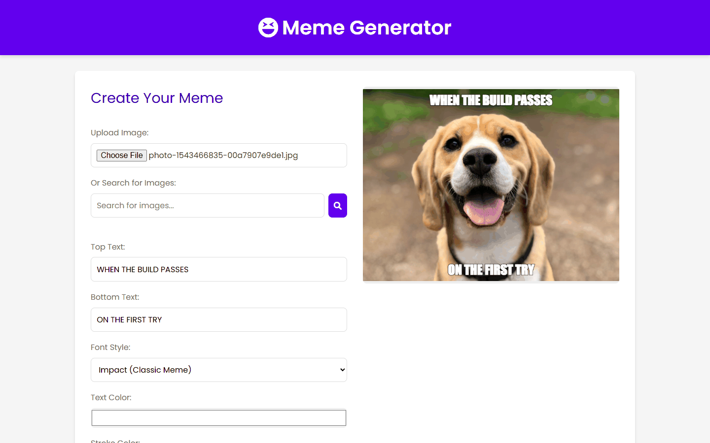
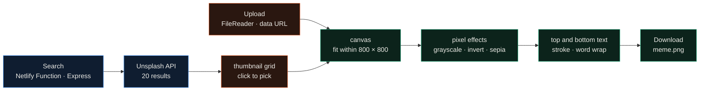
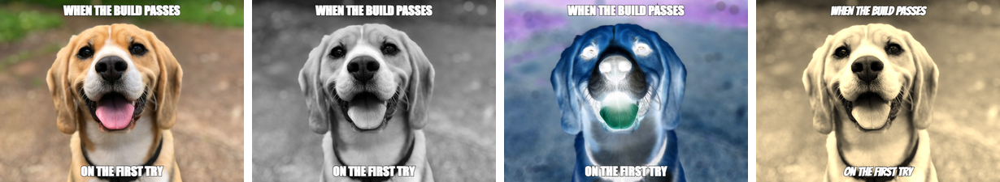

<div align="center">

# Meme Generator

**A browser meme maker: upload a photo or search Unsplash, add top and bottom text, apply pixel effects on a canvas, download a PNG.**




</div>

Lab 5 for CSCI 3172 at Dalhousie, written in March 2025. The page is plain HTML, CSS and JavaScript with no
framework. Image search goes through a small Express app running as a Netlify Function, so the Unsplash access key
stays on the server.

---

## How it works



Every change is a full redraw. The image is scaled to fit within 800 × 800 px and drawn to the canvas. If any effect
is ticked, the code reads the `ImageData` back and edits the RGBA bytes directly: grayscale replaces each channel with
the mean of R, G and B, invert takes `255 - x`, and sepia applies the usual 0.393 / 0.769 / 0.189 weight matrix
clamped at 255. The effects stack in that order. Text is drawn bold with a stroke `fontSize / 15` wide, wrapped at
90% of the canvas width, in one of 10 fonts (Impact plus nine Google Fonts) at 20 to 80 px.



The search function returns `id`, `url`, `thumb`, `alt` and the photographer's name and profile link for each
result, and the page shows the Unsplash credit in the footer when one of those images is used.

## Quickstart

```bash
npm install
npm test                                        # 17 Jest tests, Unsplash calls mocked

python -m http.server 8000 --directory frontend # upload, text and effects work without a key
```

Search needs the function running and an Unsplash access key:

```bash
echo "UNSPLASH_API_KEY=your-access-key" > .env
npx netlify dev --dir frontend                  # serves the page and /.netlify/functions/api
```

## Repository map

```text
frontend/
  index.html                 controls, preview canvas, ARIA labels
  app.js                     upload, search, canvas drawing, effects, text wrapping, download
  styles.css                 layout with one breakpoint at 900 px
netlify/functions/api.js     Express app behind serverless-http: GET /search-images
netlify.toml                 function bundling and the /api/* redirect
tests/                       API tests (supertest) and DOM / accessibility checks (jsdom)
```

## Limitations

- The bottom caption wraps downward, so a long bottom line runs off the canvas.
- A Google Font only renders after the browser has loaded it. The first Generate with a new font falls back to
  Impact; the second click draws the right font.
- On a 390 px phone the layout is slightly wider than the screen.
- The frontend tests check that elements and labels exist; they don't exercise drawing or effects.

The Unsplash request code follows the [Unsplash API docs](https://unsplash.com/documentation), and the pixel loop
follows MDN's [pixel manipulation tutorial](https://developer.mozilla.org/en-US/docs/Web/API/Canvas_API/Tutorial/Pixel_manipulation_with_canvas).
The demo photo is from Unsplash.

## License

MIT
